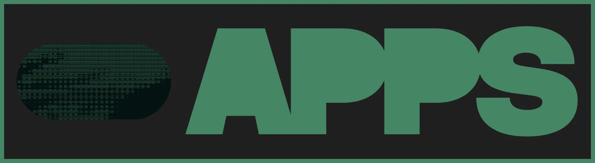

<div align="center">
  <a href="https://0morph.raulmouzo.com">
    
  </a>

  <h1>0morph</h1>

  <p>
    <strong>No uploads. No accounts. No servers watching over your shoulder.</strong>
  </p>
  <p>
    A collection of fast, private tools that run entirely in your browser.<br/>
    No backend involved — your files and data never leave your device.
  </p>

  <p>
    <a href="https://0morph.raulmouzo.com"><strong>0morph.raulmouzo.com »</strong></a>
  </p>

  <p>
    <a href="LICENSE"></a>
    
    
  </p>

  <br/>

  <a href="https://0morph.raulmouzo.com">
    
  </a>
</div>

## Features

The **image editor** is the first tool:

- **Resize** by width and height, with the aspect ratio locked or free.
- **Crop** freely or to fixed aspect ratios.
- **Rotate** by 90° steps and **flip** horizontally or vertically.
- **Limit the longest side** (e.g. 1920px, 1280px).
- **Convert** to JPEG, PNG, WebP or AVIF, with a quality control and the
  resulting file size.
- **Optimize for web** in one click.
- **Strip EXIF** and other metadata.
- **Batch edit** up to 20 images and download them as a ZIP.
- **Compare** before and after, with the size saved.

Video and audio tools are on the way.

## How it works

Everything runs on your device. Images are processed by
[wasm-vips](https://github.com/kleisauke/wasm-vips), the WebAssembly build
of [libvips](https://www.libvips.org), inside a Web Worker. There is no
upload endpoint and no account system: your files are never sent anywhere.

The threaded wasm-vips build needs `SharedArrayBuffer`, so the site is
served [cross-origin isolated](https://web.dev/articles/cross-origin-isolation-guide)
and requires a recent version of Chrome, Edge, Firefox or Safari.

## Tech stack

- [Next.js 16](https://nextjs.org) (App Router) and React 19
- [TypeScript](https://www.typescriptlang.org)
- [Tailwind CSS v4](https://tailwindcss.com) and
  [shadcn/ui](https://ui.shadcn.com) on [Base UI](https://base-ui.com)
- [wasm-vips](https://github.com/kleisauke/wasm-vips) for image processing
- [Vitest](https://vitest.dev) for tests

## Getting started

### Prerequisites

- [Node.js](https://nodejs.org) 20.9 or later
- [pnpm](https://pnpm.io) (the version is pinned in `package.json`; run
  `corepack enable` to use it)

### Installation

```bash
git clone https://github.com/raulmouzo/0morph.git
cd 0morph
pnpm install
pnpm dev
```

Open [http://localhost:3000](http://localhost:3000) to see the app.

`pnpm dev` and `pnpm build` first copy the wasm-vips browser build into
`public/vendor/wasm-vips/`, where the app loads it from at runtime.

## Scripts

| Command          | Description                                 |
| ---------------- | ------------------------------------------- |
| `pnpm dev`       | Start the dev server                        |
| `pnpm build`     | Build for production                        |
| `pnpm start`     | Run the production build                    |
| `pnpm lint`      | Lint the codebase                           |
| `pnpm format`    | Format the codebase                         |
| `pnpm typecheck` | Type-check the codebase                     |
| `pnpm test`      | Run the unit tests (in watch mode)          |

## Project structure

```
app/          routes, metadata files and route-specific components
components/   shared components; ui/ holds the primitives
hooks/        client hooks
lib/image/    image editing logic: recipe, libvips pipeline and worker
lib/          site config, categories and utilities
public/       static assets and sample images
scripts/      build helpers
```

## Contributing

Issues and pull requests are welcome. Please:

1. Keep processing client-side: no feature may send user files to a
   server.
2. Run `pnpm typecheck` and `pnpm test --run` before opening a PR.
3. Use [Conventional Commits](https://www.conventionalcommits.org)
   (`feat(images): …`, `fix(layout): …`).

See [AGENTS.md](AGENTS.md) for architecture notes and conventions.

## License

[MIT](LICENSE) © [Raúl Mouzo](https://raulmouzo.com)
